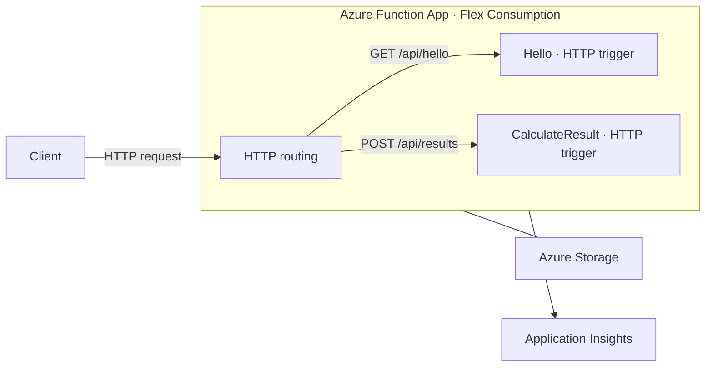
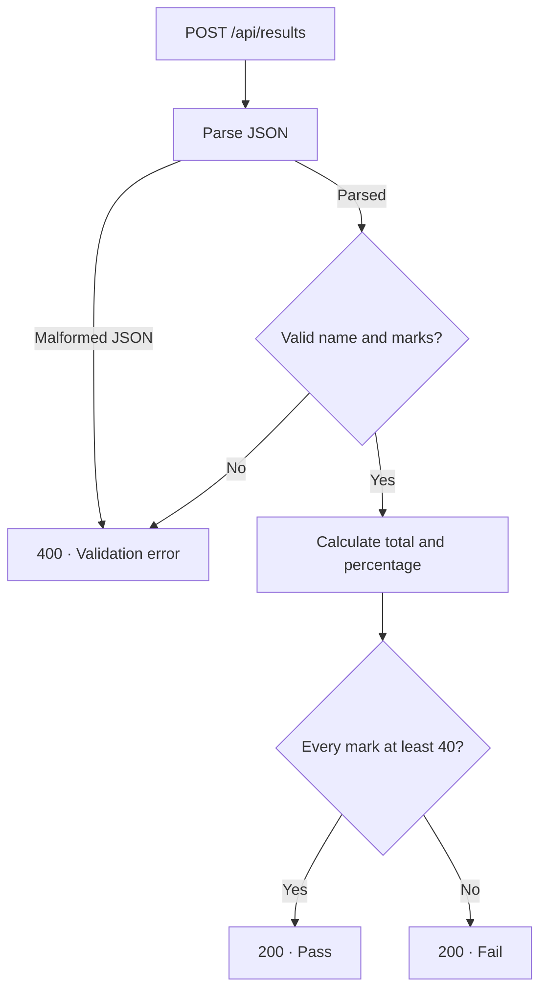
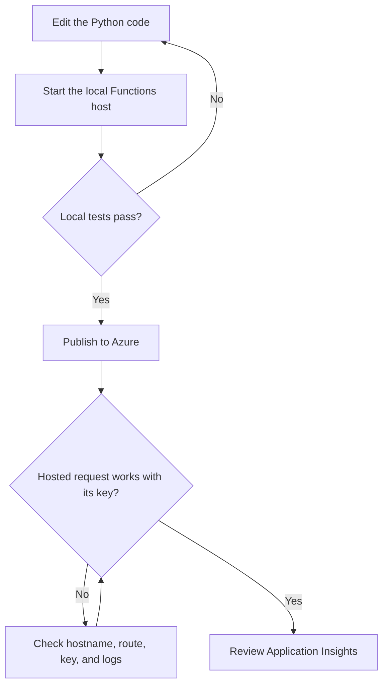

# Azure Functions Basics — 75-Minute Teaching Script

Use this script with the [Student Result API lab](https://chatgpt.com/library?file_id=libfile_0fb610a5234c8191b28c68c71135f5e0&account_id=personal). Each section pairs a classroom explanation with a demonstration and a question to check understanding.

## 1. Introduce serverless and triggers · 0–10 min

**Say:** “Imagine a student submits marks through an application. We need to calculate the total, percentage, and pass or fail. With Azure Functions, we write that calculation and specify the event that starts it. In our project, the event is an HTTP request. Azure manages the infrastructure that runs the code.”

**Draw:**



**Say:** “A **trigger** starts a function. A **function** is the handler that runs. A **function app** groups related functions for configuration and deployment. Our app contains `Hello` and `CalculateResult`. A **binding** connects a function to an input or output. For example, a queue output binding could send a message after a result is calculated.”

**Ask:** “If we want a report to run every day at 9 a.m., which trigger fits?”

**Expected answer:** A timer trigger. An HTTP trigger runs when a client sends a request.

## 2. Explain the project files · 10–20 min

| Show | Explain aloud |
|---|---|
| `function_app.py` | “This file defines both Python handlers. Each `@app.route` decorator declares the path and HTTP methods the handler accepts.” |
| `host.json` | “These settings apply across the Functions host. The `2.0` value is the configuration schema version.” |
| `local.settings.json` | “These settings apply to the local run. Copy the example file to create it. Keep any secrets out of Git. Azure has its own application settings.” |
| `requirements.txt` | “This lists the Python dependency. We install it in our virtual environment, and Azure installs it during the remote build.” |

**Say:** “Python 3.11 is the language version. Python v2 is the decorator-based programming model. Azure Functions v4 is the runtime generation.”

**Ask:** “Where can you see which HTTP methods `/api/results` accepts?”

**Expected answer:** In the `@app.route` decorator in `function_app.py`.

## 3. Demonstrate the greeting endpoint · 20–30 min

Start the local host with `func start`. Run these requests from a second terminal.

```bash
curl -i 'http://localhost:7071/api/hello?name=Atul'
curl -i 'http://localhost:7071/api/hello'
```

**Say:** “The first request sends `name=Atul` as a **query parameter**. The handler reads it from `req.params`. The second request leaves the name out, so the handler uses its default. Both calls return `200 OK` and JSON. The `-i` option displays the status and headers alongside the response body.”

**Ask:** “The decorator says `route="hello"`. Where does `/api` come from?”

**Expected answer:** `/api` is the default route prefix configured by the Functions host.

## 4. Trace the Student Result API · 30–45 min

**Say:** “This time, the client sends a JSON **request body** containing a student name and a list of marks. The handler parses the body with `req.get_json()`. It checks that the name is present and that every mark is an integer from 0 to 100. With valid input, it adds the marks, calculates the percentage, and checks each subject against the pass mark of 40. It then sends a JSON response using `func.HttpResponse`.”



Send the following request, then substitute the other score arrays in the table.

```bash
curl -i 'http://localhost:7071/api/results' \
  -H 'Content-Type: application/json' \
  --data '{"name":"Atul","marks":[80,70,90]}'
```

| Marks | Expected response | Explain |
|---|---|---|
| `[80,70,90]` | `200`, Pass, `80.0%` | The student scored 240 out of 300, and every subject meets the threshold. |
| `[90,39,95]` | `200`, Fail, `74.67%` | The API successfully calculated a result. The student failed one subject. |
| `[105]` | `400`, validation error | The mark is outside the allowed range. |

**Say:** “The status code tells us whether the API could process the request. The `result` field tells us how the student performed. The function is **stateless** because each request includes everything needed to calculate that result independently.”

## 5. Explain Azure deployment as you publish · 45–60 min

Use the provisioning commands in the lab README to create the Azure resources.

| Show | Explain aloud |
|---|---|
| Resource group | “This groups the lab resources so we can view and clean them up together.” |
| Storage account | “The deployed Functions host uses Azure Storage, including deployment storage in this setup. The student result stays in the HTTP response.” |
| Flex Consumption | “The hosting plan governs how Azure allocates compute and scales the app. A cold start is startup time a request can experience when Azure needs to start an instance.” |
| `func azure functionapp publish "$APP"` | “This packages the project, starts the remote build, and publishes both functions to the same function app.” |



**Ask:** “If we change the pass mark on our laptop, when does the Azure endpoint use the new rule?”

**Expected answer:** After we publish the updated code and it is running in Azure.

## 6. Compare local and Azure testing · 60–70 min

Set `APP_HOST` and `HELLO_KEY` using the lab README. Send the hosted GET request without the key, then send it with the key.

```bash
curl -i "https://$APP_HOST/api/hello?name=Atul"

curl -i "https://$APP_HOST/api/hello?name=Atul" \
  -H "x-functions-key: $HELLO_KEY"
```

**Say:** “Core Tools normally lets us test locally without an access key. Azure enforces the function’s authorization setting. The first hosted request should return `401 Unauthorized`. The second sends the shared **function key** in the `x-functions-key` header and should return `200 OK`.”

Send the hosted results request from the lab guide and open **Application Insights**.

**Say:** “A **request** record shows how a call to the app completed. A **trace** is a log message from the app. The calculation records the number of subjects processed, without logging the student’s name or individual marks.”

## 7. Close with a prediction exercise · 70–75 min

Ask learners to predict the status and result before testing.

| Input | Expected outcome | Reason |
|---|---|---|
| `[40,100]` | `200`, Pass | The boundary value of 40 qualifies. |
| `[39,100]` | `200`, Fail | Every subject must meet the threshold. |
| `[101]` | `400`, validation error | The mark is out of range. |
| `[49,100]` after changing the pass mark to 50 | `200`, Fail | The first mark is below the new threshold. |
| `[50,100]` after changing the pass mark to 50 | `200`, Pass | The first mark meets the new threshold. |

Ask one learner to trace the complete path aloud, from the HTTP request through the trigger, validation, calculation, and JSON response. Use the lab README to clean up the dedicated Azure resource group after the demo.
